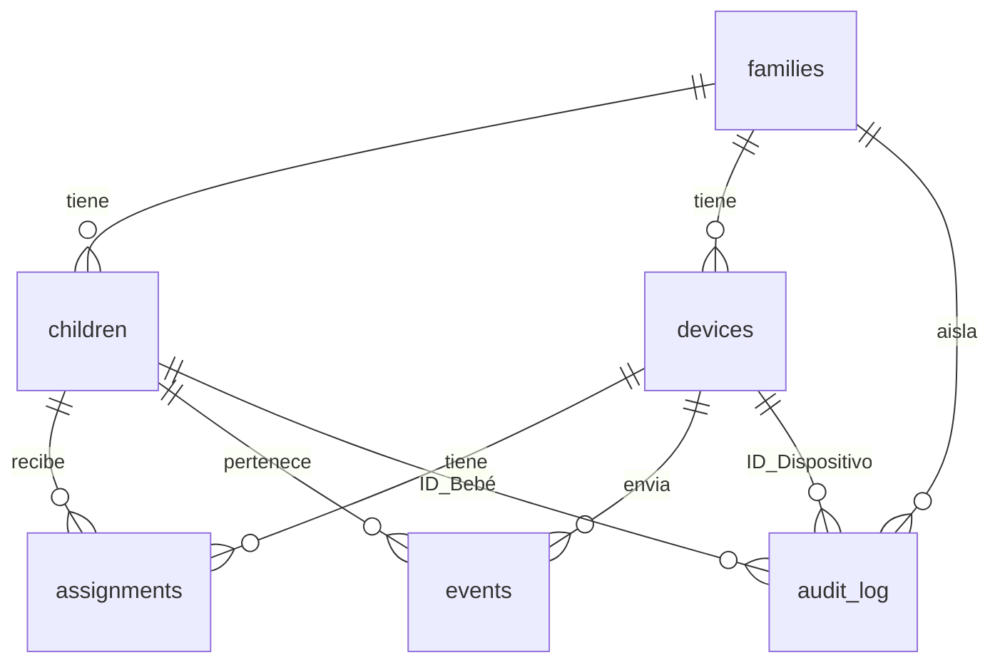

# SCRUM-20 · RF-DAT-01 · Registro unificado de eventos

Autor: Ismael M. Rama: `feature/ismael-auditoria-exportacion-telegram`.

## Qué problema resuelve

Antes, el sistema solo guardaba lecturas de sensores en `events`. No había una bitácora común que dijera qué pasó, cuándo, con qué dispositivo y con qué bebé. La tabla `audit_log` es esa bitácora. Todo evento queda con fecha, hora, tipo, detalle, bebé y dispositivo.

## Cómo funciona

Hay dos caminos de escritura y los dos terminan en la misma tabla.

El primer camino son los triggers de la base. Cuando se inserta una lectura en `events`, o cambia una fila de `assignments`, un trigger crea el renglón de auditoría en la misma transacción. Si el renglón falla, la lectura tampoco se guarda. No hay pérdida silenciosa. Ningún módulo del equipo tiene que acordarse de llamar a la auditoría.

El segundo camino es `POST /api/audit/events`. Un dispositivo autenticado con su clave envía un evento propio, por ejemplo `ALERTA_MANUAL`. El servidor busca qué bebé tenía asignado ese dispositivo en `occurred_at`. El cuerpo nunca puede elegir el bebé, aunque traiga un `child_id`, que se ignora. Este camino lo puede usar SCRUM-25 para dejar rastro de sus alertas.

La consulta es `GET /api/audit`, solo para administradores. Acepta `child`, `device`, `tipo`, `desde`, `hasta`, `limit` y `after`. SCRUM-23 reutiliza esta misma función para exportar a Excel.

## Modelo de datos



| Columna de `audit_log` | Tipo | Campo del SRS | Nota |
| --- | --- | --- | --- |
| `event_date` | DATE, AAAA-MM-DD | Fecha | Hora local de Costa Rica |
| `event_time` | TIME, HH:MM:SS | Hora | Hora local de Costa Rica |
| `event_type` | VARCHAR(50) | Tipo_de_Evento | `LECTURA`, `ASIGNACION`, `DESASIGNACION`, `ACTIVACION`, `DESACTIVACION`, `NOTIFICACION_ENVIADA`, `NOTIFICACION_FALLIDA` (SCRUM-24, solo las crea el sistema) y los que envíen dispositivos |
| `detail` | TEXT | Descripción_Detalle | Hasta 1000 caracteres |
| `child_id` | UUID, FK a `children` | ID_Bebé | Siempre sale de la asignación |
| `device_uuid` | UUID, FK a `devices(uuid)` | ID_Dispositivo | Ver `uuid-dispositivos.md` |
| `device_id` | texto, FK a `devices` | extra | Identificador operativo, como `TEMP-01` |
| `occurred_at` | instante UTC | extra | Fuente de fecha y hora |
| `severity` | info, warning, critical | extra | |
| `source_event_id` | texto único | extra | Evita duplicados y permite reintentos |
| `family_id` | UUID | extra | Aislamiento entre familias |

En SQLite `event_date` y `event_time` son columnas generadas desde `occurred_at`. En Postgres las llena un trigger, porque la conversión de zona horaria no es inmutable. La tabla no admite UPDATE ni DELETE.

**Corregido con el UUID.** La primera entrega guardaba `ID_Dispositivo` como texto. Ahora cada dispositivo tiene un `uuid` persistente y `audit_log.device_uuid` es una clave foránea real hacia él. El texto `TEMP-01` sigue siendo el identificador operativo. El diseño de doble identificador y su aprobación pendiente están en `uuid-dispositivos.md`.

**Hora de Costa Rica.** Costa Rica es UTC-6 todo el año. En SQLite uso el desplazamiento fijo, sin depender de tzdata en Windows. Un evento a las 05:59:59 UTC se registra el día anterior a las 23:59:59.

## Comportamiento ante casos límite

| Caso | Resultado |
| --- | --- |
| Clave de dispositivo inválida o dispositivo inexistente | 403, sin revelar cuál falló |
| Dispositivo sin bebé asignado en esa fecha | 409. No se guarda nada ni se inventa un bebé |
| Mismo `event_id` y mismo contenido | 200 con el mismo resultado, sin duplicar |
| Mismo `event_id` y otro contenido | 409 |
| Tipo reservado enviado por un dispositivo | 403 |
| Fallo de la base al guardar | 500 y reversión completa. El dispositivo reintenta con el mismo UUID |
| Cuidador o usuario sin sesión | 403 o 401 |
| Bebé o dispositivo de otra familia | 404 |

El servidor no escribe logs de solicitudes, porque pueden contener identificadores de menores.

## Archivos

Nuevos: `cuna/auditoria.py`, `supabase/003_auditoria.sql`, `tests/apoyo.py`, `tests/test_auditoria.py`, `tests/test_cloud_auditoria.py`, `tests/postgres/` y este documento.

Modificados, con cambios pequeños:
- `cuna/local.py`: agrega `record`, `audit_page` y `authenticate_device`. Además cambia el arranque: `migraciones.migrar` reemplaza a `executescript(SCHEMA)` y `devices` sale del `SCHEMA` base para que lo cree la migración con la columna `uuid`. Ese último cambio toca el modelo de Sebastián y está pendiente de su aprobación. Ver `INTEGRACION-pendientes.md`.
- `cuna/cloud.py`: agrega `record` y `audit_page` al final.
- `app.py`: dos rutas nuevas y un método `device_key` que extrae la clave Bearer y solo lo usa `/api/audit/events`. `/api/events` y `response()` conservan su código original.

## Cómo probar

```powershell
python -m unittest discover -s tests -v
```

Para Supabase, con una base PostgreSQL vacía y desechable:

```bash
PGURL=postgresql://postgres@localhost:5432/prueba tests/postgres/ejecutar.sh
```

Ejemplo manual con el simulador corriendo y un dispositivo `TEMP-01` asignado:

```powershell
$h = @{ Authorization = "Bearer <clave del dispositivo>" }
$body = @{ event_id = [guid]::NewGuid().ToString(); device_id = "TEMP-01"; event_type = "ALERTA_MANUAL"; detail = "Prueba"; occurred_at = (Get-Date).ToUniversalTime().ToString("o") } | ConvertTo-Json
Invoke-RestMethod -Uri http://127.0.0.1:8000/api/audit/events -Method Post -Headers $h -Body $body -ContentType "application/json"
```

Para consultar, abre sesión en el panel y visita `http://127.0.0.1:8000/api/audit?tipo=LECTURA&limit=20`.

## Resultados observados

La cifra de abajo es la de la primera entrega. Las pruebas vigentes están en `pruebas.md`.

El 18 de noviembre de 2026, con Python 3.13 y SQLite 3.53, se ejecutaron 24 pruebas y todas pasaron: las 6 originales del equipo y 18 nuevas. En PostgreSQL 16 real se ejecutaron 22 verificaciones sobre las migraciones 001 y 003, y todas pasaron.

Errores encontrados y corregidos durante el desarrollo: si el dispositivo no enviaba `occurred_at`, el servidor ponía su propia hora y un reintento cambiaba el contenido. Ahora `occurred_at` es obligatorio, igual que `captured_at` en las lecturas.

**No verificado.** `Cloud.audit_page` y `Cloud.record` solo tienen prueba unitaria de la forma de las consultas. No se ejecutaron contra un proyecto real de Supabase ni contra PostgREST. Las reglas de la base sí se probaron.

## Limitaciones conocidas

La auditoría no guarda quién hizo el cambio de asignación o de estado, porque el trigger no conoce al usuario en SQLite. En Supabase podría usarse `auth.uid()`. Es una extensión posible, pero no la pide el SRS.

Los cambios de estado anteriores a la migración no se pueden reconstruir. El relleno cubre lecturas y asignaciones.
